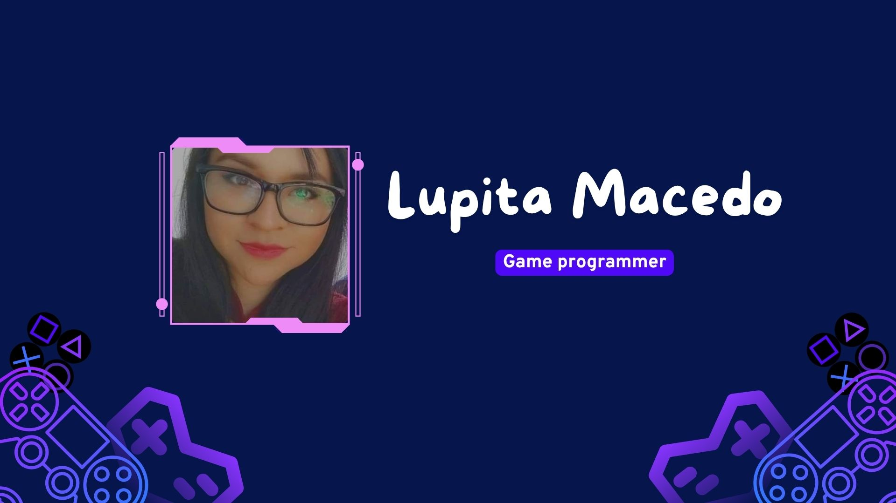
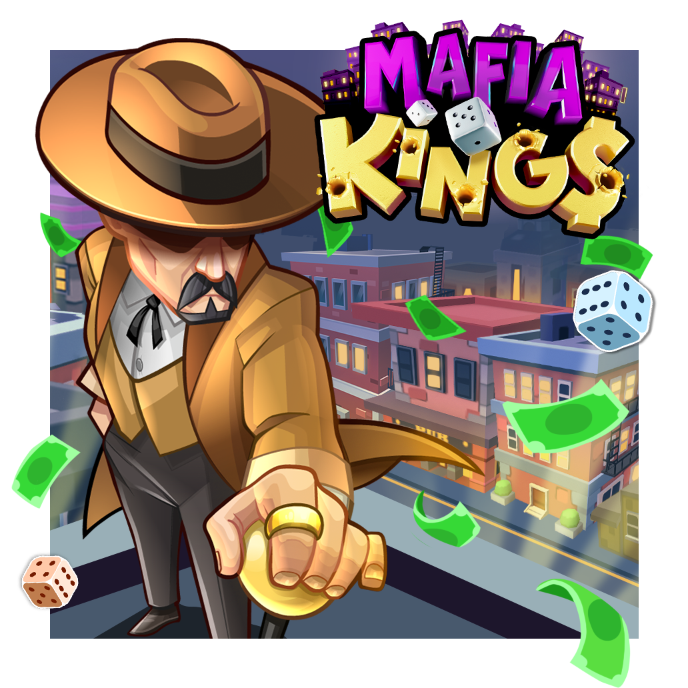
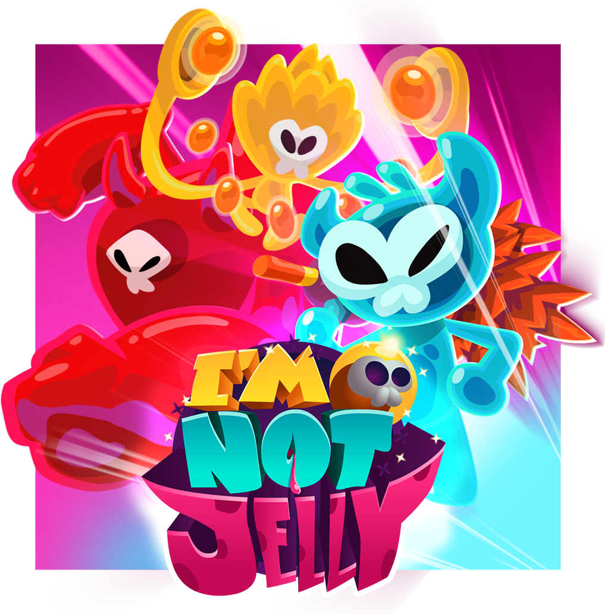
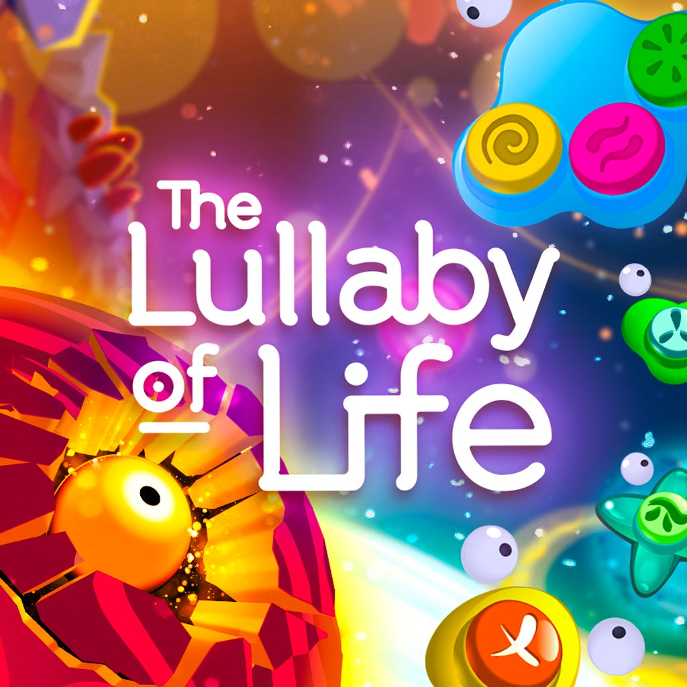
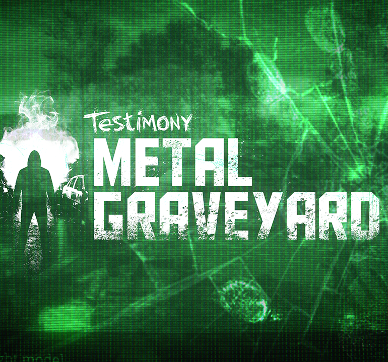
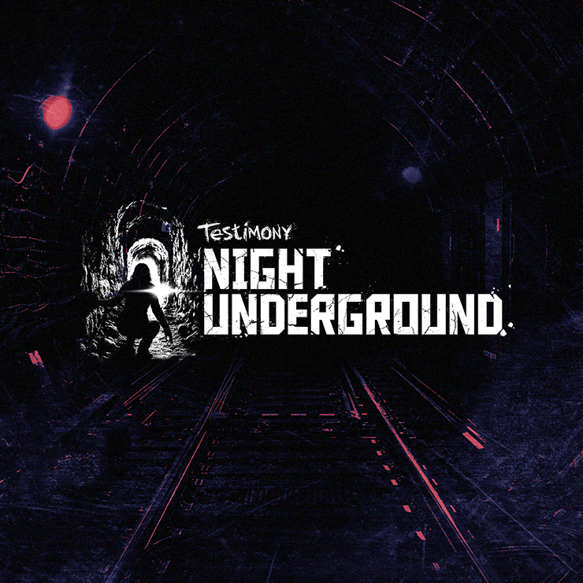

  <h1>Hi there 👋 I'm Lupita Macedo</h1>

 

## About me

- 🎮 Game Programmer with 5+ years of professional experience
- 💻 Mainly working with Unity & C#, with experience in Godot and Unreal Engine
- 🧠 Focused on gameplay systems, game AI & performance
- 🐞 Enjoy solving problems, debugging & building reusable systems
- 📋 Experience in game production & multidisciplinary team coordination
- 🌱 Always learning new technologies and game engines

 

## Games I've Worked On

<table>

  <tr>
    <td width="50%" valign="top">
      <h3 align="center">Mafia Kings</h3>
      

        
        
<strong>Game Programmer</strong>

        

          Worked on assigned programming tasks,
          implementing and maintaining game features
          with guidance from the programming lead.
        

        
      

    </td>
    <td width="50%" valign="top">
      <h3 align="center">I'm Not Jelly</h3>
      

        
        
<strong>Game Programmer</strong>

        

          Contributed to game development by
          implementing programming tasks, fixing bugs,
          and supporting gameplay features.
        

        
      

    </td>
  </tr>

  <!-- Row 2 -->
  <tr>
    <td width="50%" valign="top">
      <h3 align="center">The Lullaby of Life</h3>
      

        
        
<strong>Game Programmer</strong>

        

          Worked with the development team on
          programming tasks, gameplay features,
          and technical improvements.
        

        
        
      

    </td>
    <td width="50%" valign="top">
      <h3 align="center">Testimony: Metal Graveyard</h3>
      

        
        
<strong>Game Programmer</strong>

        

          Worked as the main programmer on gameplay
          features and technical systems, with
          support from the technical lead.
        

        
      

    </td>
  </tr>

  <!-- Row 3 -->
  <tr>
    <td width="50%" valign="top">
      <h3 align="center">Testimony: Night Underground</h3>
      

        
        
<strong>Main Programmer & Game Producer</strong>

        

          Responsible for gameplay programming and
          production tasks, including team coordination,
          schedules, and Scrum meetings.
        

        
      

    </td>
    <td width="50%" valign="top">
      <h3 align="center">Upcoming Testimony Game</h3>
      

        
        
<strong>Main Programmer & Game Producer</strong>

        

          Developed gameplay systems and NPC/enemy AI,
          including detection, navigation, and
          state-based behaviors. Also coordinated
          production tasks and team schedules.
        

        
      

    </td>
  </tr>
</table>
